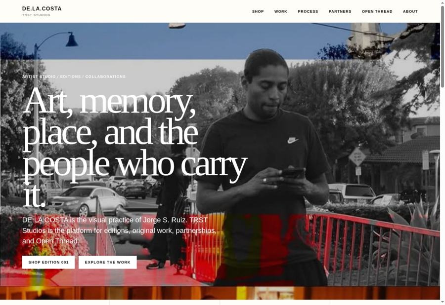

# TRST Studios — production rollout, November 3, 2026

The user authorized the live rollout and explicitly deferred email integration. The tested site is now deployed to the existing production project and public custom domains.

| Item | Verified value |
| --- | --- |
| Public site | https://trststudios.online/ |
| Additional domain | https://www.trststudios.online/ |
| Vercel project | trststudios.online / prj_aBlXRunfVCyeMv5X9rNGVDx8O9WN |
| Active deployment | dpl_CTrFNtihxZAq8mBRdTSPBT5294WY — READY, production |
| Pinned Git source | 02ebd26656a7f1a9e66843636ba963a4a0e3ef2c |
| Tested runtime source within release | f938f22251c0337022c3c7f664bd6101a86af801 |
| Production runtime | Node 24.x, aligned with package.json and the tested preview |
| Prior production / rollback reference | dpl_BLBxGBE21f2fer9o4BW2y85bShMF, CLI metadata SHA fde2abe29239f210260ee61d89876708e4343915 |
| Development branch | creative/trststudios-site-lab |
| Upstream review | https://github.com/top-doggg/topdoggg/pull/10 |

## Source reconciliation

The old CLI metadata ref/commit is not available as a fetchable source ref in the accessible Git repository. The release was reconciled against the actual storefront branch (ee14b55), existing live routes/UI, and the protected preview evidence. The scoped runtime differences are the documented media, gallery, responsive-layout, intake-status, film-range, and authorization fixes. Product art, product prices, route definitions, and the dependency lockfile were preserved. The user explicitly authorized replacing the live deployment with the verified release. The prior immutable deployment remains available; its pre-existing media failures are documented in the original audit.

## Production storage and configuration

Production uses the existing private media/subscriber store, store_UM16dCIx7fpsssNf. All nine allow-listed media paths were verified present before rollout. No customer records were migrated or copied into Lab. Creative Lab continues to use its separate isolated store.

The existing production store credential is installed only in the production environment. Production operations, unsubscribe, and cron signing keys are independent of Lab. TRST_SITE_ORIGIN points to the public origin. Secret values are excluded from the repository and this report. Resend configuration remains absent, as requested.

The first rollout build, dpl_AQMhHNR66jgmtDHMTWC76R9ZDnrC, passed page/SEO checks but its Blob handlers returned 403 upstream. Runtime logs and the installed SDK identified the cause: BLOB_STORE_ID makes the SDK prefer project OIDC, but the production project has no managed OIDC connection to the legacy store. Renamed that informational value to TRST_PRODUCTION_BLOB_STORE_REFERENCE so the SDK uses the existing authorized BLOB_READ_WRITE_TOKEN. The corrected deployment above is serving the custom domains. Future configuration must preserve this distinction unless a managed store connection is deliberately established.

## Verification on the public domain

- All 19 HTTP integration checks passed: seven page shells, seven homepage image keys, profile, film, subscriber readiness, and anonymous operations/Printify denial boundaries.
- All eight deployment/discovery checks passed: homepage, journal index, three article pages, RSS, sitemap, and IndexNow key file.
- Film initial and suffix ranges returned 206 with exactly 1,024 bytes and correct Content-Range. An unsatisfiable range returned 416 with zero body bytes.
- Vercel domain lookup confirmed the public hostname maps to the corrected production deployment and pinned source.
- Browser verification showed all three homepage images decoded on the public origin. The Realest Feeling Front/Back controls selected distinct correct mockups. The Never Alone process lightbox opened with a decoded image and dismissed by Escape.
- At 340 CSS px, Process, Shop, Work, and About fit within the viewport, and mobile menu navigation worked. The browser was restored to its normal desktop viewport. These are responsive desktop-browser checks, not physical-device emulation.
- The live De Los Cielos quick-view action opened the correct Printify product URL. The product displayed its expected $29.58 starting price and an enabled Add to cart control. No order was placed.
- A unique synthetic production signup returned 200 and was read back from the existing production store with `emailDelivery:not_configured`. Only that generated test record was deleted, and its absence was verified. No production customer records were modified.
- The previous seven source tests and protected-preview CI remain applicable: the deployed runtime source is unchanged, and the rollout corrections were environment configuration only.

## Deferred items

Actual email delivery, operations login email, and inquiry notifications need a usable Resend API key and verified sender. This is intentionally deferred and is not a rollout blocker. Storage readiness is not described as email delivery. Supabase remains inactive and unused by this storefront. Authenticated Printify management synchronization and account-side Codex Cloud workspace setup remain separate from the working public product/checkout and development-branch flows.

## Live capture

